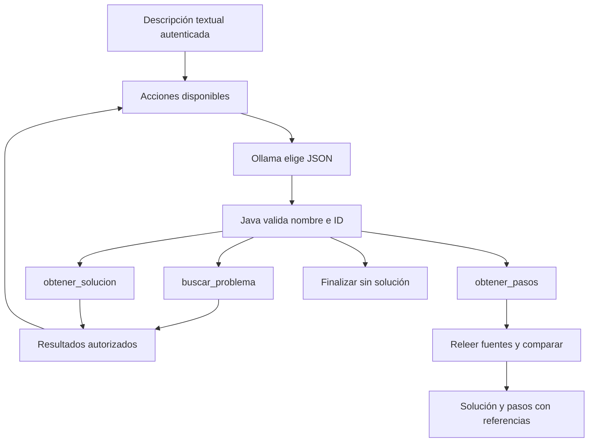

# Agente textual de consulta: etapa 7 de 8

El botón **Agente textual** abre una pantalla separada del chatbot. Admite una
descripción escrita o pegada de hasta 1000 caracteres y consulta únicamente
conocimiento publicado y activo. No muestra controles para imágenes o archivos,
no llama al modelo de visión y no publica, modifica, envía ni ejecuta acciones
externas. La extracción multimodal sigue perteneciendo al chatbot.

La diferencia respecto del chatbot es la elección de herramientas: el modelo
decide qué problema explorar, qué soluciones leer y de cuál obtener los pasos.
Java valida esas decisiones y compone la respuesta final con los datos leídos.
El modelo no genera SQL ni el texto de la solución final.

## Herramientas permitidas

| Herramienta | Argumento | Lectura autorizada |
|---|---|---|
| `buscar_problema` | ID de protocolo `0` | Busca la pregunta original mediante el RAG híbrido existente |
| `obtener_solucion` | ID de un problema encontrado en esta consulta | Hasta cinco soluciones activas; indica principal y orden |
| `obtener_pasos` | ID de una solución leída en esta consulta | Hasta veinte pasos activos, ordenados por orden e ID |

El primer paso solo permite buscar. Después el modelo elige entre los IDs
recuperados, puede explorar otro problema o solución y puede abstenerse. No puede
recuperar un ID recordado de una consulta anterior ni repetir una misma llamada.
El protocolo incluye `finalizar` con ID `0` para abstenerse. Es una orden de
control, no una cuarta herramienta con acceso al sistema. Elegir `obtener_pasos`
con un ID autorizado expresa la elección de solución: Java lee esos pasos,
revalida las fuentes y compone la respuesta, aunque la lista esté vacía. No hace
una cuarta llamada al modelo para repetir una decisión que ya quedó en ese ID.

El esquema JSON de cada turno contiene los nombres e IDs disponibles. El servidor
vuelve a comprobar la combinación exacta, tipos enteros, campos permitidos,
modelo esperado y límites de salida. Una respuesta con acciones ajenas, imágenes,
SQL, campos extra, IDs no disponibles o razonamiento libre no se ejecuta.



## Seguridad, vigencia y límites

El agente reutiliza JDBC, los clientes Ollama, la búsqueda híbrida y la validación
de huellas del monolito. No agrega frameworks, dependencias, procesos Python ni
migraciones. PostgreSQL conserva V12. La búsqueda usa texto completo español y
coseno acotado en Java porque la instalación no tiene pgvector; no se incorpora
un índice ANN en esta etapa. Las fuentes del índice textual excluyen imágenes.

Las herramientas leen con SQL fijo y parametrizado. Verifican publicación y
actividad del problema, área, subárea y solución; los pasos también deben estar
activos. No basta con que el modelo conozca un ID: debe pertenecer a los resultados
de la ejecución actual. La huella completa de las fuentes encontradas se valida
antes y después de cada decisión. Antes de responder se releen solución y pasos
y se comparan sus valores y orden, además de volver a verificar la huella.
Un cambio concurrente retira la respuesta y deja las fuentes vacías. Como en RAG,
un cambio posterior a la última lectura se observará en la próxima consulta.

Se presentan hasta 1200 caracteres de descripción por solución y 600 por paso.
Si el texto real supera esos límites, o hay más de cinco soluciones o veinte
pasos, se abstiene con `LIMITE_FUENTES`; no presenta instrucciones recortadas como
si fueran completas. La información enviada al modelo para decidir sí se acota
al presupuesto global de prompts y puede truncarse. En ese caso la respuesta
indica `busquedaAcotada=true` y la pantalla advierte el límite de búsqueda o contexto.
La respuesta final, si existe, usa el texto completo de las filas admitidas.

Cada solicitud admite como máximo seis decisiones del modelo por defecto y una
sola ejecución del agente a la vez. Comparte el turno de Ollama con chatbot e
indexador: puede devolver ocupado. El timeout total se comprueba entre operaciones
y antes de entregar resultados. Una inferencia iniciada puede terminar después
del presupuesto, pero se descarta; conserva además su timeout HTTP de Ollama.
Cancelar en la pantalla interrumpe la espera y descarta respuestas tardías, sin
garantizar la interrupción inmediata del trabajo del servidor.

La traza de herramientas completadas contiene nombre, ID y estado `OK` en el DTO;
la pantalla la muestra como consultas realizadas. El log registra solo el nombre
fijo de cada herramienta completada, sin pregunta, prompt, contenido ni argumentos.
La auditoría de acceso existente conserva usuario, método, ruta e IP. No se crea
una tabla con conversaciones. El historial del agente es independiente del chatbot,
permanece en memoria y se limita a diez intercambios; cada pregunta es independiente.

Una respuesta válida incluye descripción de la solución, indicación de principal
cuando corresponda, pasos en orden y referencias navegables al problema, solución
y pasos. **Abrir solución** navega a `/problemas/{id}#solucion-{id}`, despliega
la solución citada y la lleva a la vista, incluso cuando no es la principal.
Las rutas y anclas se construyen con IDs numéricos válidos.
Es una composición determinista de evidencia; no garantiza que el modelo
haya elegido el problema más relevante. Esa precisión requiere una evaluación más
amplia en la etapa 8. El esquema restringido no convierte el modelo en infalible.

Cuando no hay evidencia utilizable, la respuesta textual es:

> No se encontró una solución suficientemente relacionada en la Base de Conocimientos. Intentá describir el problema con más detalles.

No se ofrece crear tickets ni acciones alternativas. La pantalla diferencia
límites de iteraciones, fuentes modificadas y acciones inválidas.

## API y activación Windows

`POST /api/rag/agente`, con JWT de ADMINISTRADOR, EDITOR o LECTOR y cuerpo
JSON `{"pregunta":"¿Qué pasos sigo para corregir E17?"}`. Solo admite el campo
textual `pregunta`; rechaza campos adicionales y multipart con archivos. Mantiene
el límite de cuerpo de 16 KiB del filtro RAG, validación de pregunta y no-store.
Devuelve `estado`, `texto`, `modelo`, `fuentes`, `busquedaAcotada` y `herramientas`.

Estados de respuesta: `CON_FUENTES`, `SIN_SOLUCION`, `ACCION_INVALIDA`,
`LIMITE_ITERACIONES`, `LIMITE_FUENTES` y `FUENTES_ACTUALIZADAS`.
Errores principales: 503 `AGENTE_DESHABILITADO`, `RAG_DESHABILITADO` o
`AGENTE_FUENTES_NO_DISPONIBLES`; 429 `AGENTE_OCUPADO`; 400
`AGENTE_PREGUNTA_INVALIDA`/`DATOS_INVALIDOS`; 413 `AGENTE_CONTEXTO_INSUFICIENTE`;
504 `AGENTE_TIMEOUT`, además de los códigos controlados de RAG y Ollama.

| Variable | Predeterminado |
|---|---|
| `AGENT_ENABLED` | `false` |
| `AGENT_MAX_ITERATIONS` | `6`, entre 1 y 10 |
| `AGENT_TIMEOUT` | `600s`, máximo 15 minutos |
| `OLLAMA_AGENT_MODEL` | `granite4.2:3b` |

Conservar `IA_ENABLED=true`, `RAG_ENABLED=true`, el índice preparado y el modelo
de embeddings. Crear o editar el archivo privado `.local/agente-config.json`:

```json
{
  "AGENT_ENABLED": "true",
  "AGENT_MAX_ITERATIONS": "6",
  "AGENT_TIMEOUT": "600s"
}
```

Recompilar el backend y reiniciarlo con los scripts Windows habituales. El
lanzador valida esas tres variables; la configuración local tiene prioridad.
La pantalla usa un timeout de 660 segundos para el agente. Si se amplía el
presupuesto del servidor, revisar también el cliente. Para desactivar el agente
sin afectar el chatbot ni el CRUD, usar `AGENT_ENABLED=false` y reiniciar.

Se mantiene `granite4.2:3b`: Qwen3 instalado había sido rechazado por su salida
Thinking, según la evaluación previa. No se descargan modelos en esta etapa.
La selección de herramientas se prueba con el modelo real antes de habilitarla
localmente. El ensayo sintético positivo ejecutó las tres herramientas en
aproximadamente 206 segundos en este equipo, incluyendo las cargas del modelo.
Una consulta puede tardar varios minutos; no es una garantía de latencia ni de
precisión sobre el catálogo real. Comandos y evidencia en [PRUEBAS_IA.md](PRUEBAS_IA.md).

La versión inicial pedía una cuarta decisión para finalizar. En dos pruebas
reales el modelo llamó correctamente las tres herramientas y luego se abstuvo,
incluso conservando un resumen de las soluciones. El cierre actual utiliza el ID
que el modelo eligió al pedir los pasos y deja la composición y comprobación final
en Java. Se mantienen la posibilidad de abstenerse antes de elegir solución y
las mismas validaciones de permisos, referencias, vigencia y argumentos.
