# Índice y consulta del conocimiento: etapas 4 y 5 de IA

La etapa 4 prepara las fuentes y la etapa 5 agrega búsqueda híbrida y respuestas
con evidencia. La pantalla del chatbot y las herramientas del agente corresponden
a las etapas 6 y 7. El conocimiento original sigue siendo la fuente de verdad.

## Datos y arquitectura

El módulo `rag` utiliza JDBC y las interfaces de IA existentes dentro del
monolito. Las migraciones nuevas son V11 (tablas y vista portables) y V12
(índice GIN de texto español, únicamente PostgreSQL). Las migraciones anteriores
no se modifican. No se agregan dependencias Maven ni servicios externos.

```mermaid
flowchart LR
    CRUD[Guardado existente] --> Datos[(Conocimiento original)]
    Barrido[Planificador y lease] --> Datos
    Datos --> Snapshot[Snapshot y huella]
    Snapshot --> Fragmentos[Texto y fragmentación]
    Fragmentos --> Ollama[Embeddings locales opcionales]
    Fragmentos -->|Modo textual| Indice
    Ollama --> Indice[(Índice derivado)]
    Indice --> Vista[Fuentes vigentes]
    Datos --> Vista
    Vista --> Recuperacion[Texto completo y coseno acotado]
    Pregunta[Consulta autenticada] --> Recuperacion
    Recuperacion --> Fusion[Fusión RRF y comprobación de vigencia]
    Fusion --> Modelo[Ollama selecciona una cita]
    Modelo --> Validacion[Cita literal y vigencia comprobadas]
    Validacion --> Respuesta[Respuesta con fuente o abstención]
```



| Tabla/vista | Contenido |
|---|---|
| `rag_control` | Cursor de barrido, generación de reconstrucción y lease del trabajador |
| `rag_estado` | Huella de las fuentes, estado, intentos, código de error y próxima oportunidad |
| `rag_fragmentos` | Texto derivado, origen, versiones, página y vector opcional |
| `rag_fragmentos_vigentes` | Fragmentos listos cuyo origen continúa autorizado y vigente |

Los fragmentos conservan tipo e identificador de origen, problema, solución,
paso y archivo cuando corresponden, área, subárea, estado, activo, versión del
origen y del problema, fecha de modificación y posición. Para PDF se conserva
la página extraída; DOCX y texto del editor no inventan paginación.
La navegación se podrá construir con los identificadores y las rutas existentes
de problemas, soluciones y descarga privada; no se guardan rutas físicas públicas.

Se indexan exclusivamente problemas PUBLICADOS y activos con área y subárea
activas. Se usan título, descripción textual del editor, área, subárea, etiquetas
activas, soluciones activas, pasos activos y PDF/DOCX activos de esos tres niveles.
Las imágenes no se incorporan a este índice textual. Un PDF escaneado puede
aportar texto reconocido por el OCR de la etapa 3. Los adjuntos usan su hash
SHA-256 registrado y una ruta verificada dentro del storage antes de extraerse;
no se modifican ni se duplican los binarios originales.

Los archivos cargados para una consulta temporal del chatbot no se publican en
el índice. Solo los adjuntos que ya pertenecen al conocimiento entran en este
proceso. TXT y texto escrito en el futuro chat serán consultas, no publicaciones
automáticas. El texto del editor ya cuenta con una representación plana existente.

## Actualización y concurrencia

Un barrido incremental lee snapshots consistentes con aislamiento REPEATABLE READ.
Su huella SHA-256 incluye fuentes, contenido, metadatos y configuración del
fragmentador/modelo. Detecta altas, ediciones, publicación, archivo, baja lógica,
movimientos de área/subárea, etiquetas, soluciones, pasos y adjuntos.
Los snapshots sin cambios se omiten sin llamar a Ollama ni reescribir fragmentos.

Se eligió reconciliación periódica para cubrir también cambios realizados por
las distintas rutas existentes, sin introducir llamadas de IA en sus transacciones.
El guardado normal no depende del índice. La actualización es eventual: no hay
una promesa de sincronización inmediata ni una cola de eventos por cada edición.
Cada ciclo recorre hasta diez problemas en orden de ID y luego continúa desde
un cursor persistido. Al llegar al final vuelve al comienzo. El tiempo de un
barrido depende del tamaño del catálogo, archivos y latencia del modelo.

El lease se toma en una transacción corta sobre la única fila de control y
vence a los diez minutos. Solo un trabajador del conjunto de instancias procesa
el índice a la vez. Extracción e inferencia ocurren fuera de esa transacción;
no se mantienen bloqueos sobre las entidades de conocimiento mientras corre IA.
Si cae el proceso, el lease vence y el barrido vuelve a visitar sus fuentes.

Antes de publicar se releen las fuentes y se compara su huella. Si cambiaron,
se descarta el resultado y una vuelta posterior lo recalcula. La sustitución de
fragmentos y el estado LISTO son atómicos. Una generación de reconstrucción o
lease distinto impide que un trabajador anterior publique resultados tardíos.
Las versiones y controles de concurrencia del CRUD existente se conservan.

La vista `rag_fragmentos_vigentes` verifica nuevamente publicación y actividad
del problema y sus padres, actividad de solución/paso/archivo, versiones del
origen y del problema y estado LISTO con huella coincidente. Una baja o un cambio
de versión puede dejar de ser visible antes del siguiente barrido. No se debe
consultar `rag_fragmentos` directamente desde la búsqueda ni tratar el
estado copiado del índice como una autorización. La etapa 5 vuelve a validar
fuentes y permisos antes de entregar contexto o citas al usuario.

## Fragmentación y embeddings

El fragmentador normaliza Unicode NFC, espacios y controles. Divide el texto en
fragmentos de hasta 600 unidades UTF-16 con solapamiento de 80, buscando límites
de palabra y sin romper pares sustitutos. No se trunca un problema demasiado
grande: se registra un fallo explícito para revisión y reintento.

`embeddinggemma:300m` es el modelo local elegido para embeddings, independiente
de `granite4.2:3b` para conversación. Se instaló desde la
[biblioteca oficial de Ollama](https://ollama.com/library/embeddinggemma:300m).
La descarga ronda 622 MB. Las llamadas pasan por el cliente local de la etapa 2,
con límites, un solo turno de IA y `keep_alive=0`. No se descargan modelos desde
el indexador ni durante los tests. El texto documental sigue siendo datos no
confiables y no se ejecutan sus instrucciones.

En esta instalación Windows no está disponible `vector.control` de pgvector.
Por eso V11 almacena vectores como JSON en una columna TEXT junto al modelo y
la dimensión, sin forzar extensiones ni compilar componentes nativos. V12 agrega
el índice textual nativo `to_tsvector('spanish', texto)`. La etapa 5 compara
vectores mediante coseno acotado en Java y filtros previos. No utiliza un índice
ANN. Una migración posterior a pgvector es una opción para ampliar la escala.
Esta alternativa permite validar el catálogo local;
su escalabilidad deberá medirse antes de usar catálogos grandes.

`RAG_EMBEDDINGS_ENABLED=false` permite preparar un índice textual sin Ollama.
Con embeddings activados, un fallo del modelo deja el problema en ERROR; no se
presenta una vectorización incompleta como exitosa. Cambiar modelo, fragmentación
o modo textual cambia la huella y obliga a regenerar. Si se reemplaza el contenido
de una etiqueta Ollama por otro modelo con el mismo nombre, reconstruir el índice
explícitamente: el nombre del modelo no identifica de forma inmutable sus pesos.

## Fallos y límites

Un problema fallido conserva un código técnico seguro, sin documentos ni prompts
en logs. Se retiran sus fragmentos derivados para no servir una preparación
parcial. Se realizan hasta tres intentos para la misma huella, con esperas de
60 segundos multiplicados por el número de intento. Un cambio de fuentes válidas
reinicia esa cuenta; también existe un reintento administrativo explícito.
Si falla la lectura del snapshot antes de poder calcular una huella, agotados
los intentos es necesario solicitar un reintento administrativo tras corregirlo.
Los códigos y estados persisten entre reinicios.

Valores predeterminados:

| Variable | Valor |
|---|---|
| `RAG_INDEX_ENABLED` | `false` |
| `RAG_EMBEDDINGS_ENABLED` | `false` |
| `RAG_CHUNK_SIZE` / `RAG_CHUNK_OVERLAP` | `600` / `80` |
| `RAG_MAX_CHUNKS` | `128` por problema |
| `RAG_MAX_SOURCES` | `100` fuentes por problema |
| `RAG_MAX_ATTACHMENTS` | `3` PDF/DOCX por problema |
| `RAG_INDEX_TIMEOUT` | `120s` |
| `RAG_INDEX_INTERVAL` | `15000` ms entre ciclos |
| `RAG_INDEX_INITIAL_DELAY` | `30000` ms antes del primer ciclo |

El texto de las fuentes se limita a 200 000 caracteres en conjunto y hasta 200
etiquetas activas. Las filas se leen por lotes acotados y se interrumpe la lectura
al alcanzar un límite, sin acumular todo el catálogo. Los límites
de archivos y OCR de la etapa 3 siguen vigentes. El presupuesto de indexación
se comprueba entre operaciones y antes de publicar; una llamada en curso tiene
su propio timeout y puede terminar después de ese presupuesto. No se publica
ese resultado tardío. Dos hilos de planificación permiten que la limpieza
documental siga funcionando durante una indexación larga.

## Administración y arranque

Las operaciones requieren JWT de ADMINISTRADOR. LECTOR y EDITOR reciben 403;
anónimo recibe 401. La API devuelve DTO y contadores, nunca entidades JPA,
vectores, contenido privado de fuentes ni rutas físicas.

| Método y ruta | Resultado |
|---|---|
| `GET /api/ia/indice` | Habilitación, modo embeddings y contadores/cursor |
| `POST /api/ia/indice/reconstruir` | 202; invalida trabajos anteriores y prepara reconstrucción |
| `POST /api/ia/indice/reintentar` | 202; habilita un nuevo recorrido de los fallidos |

Las órdenes no ejecutan extracción o inferencia dentro de la solicitud HTTP.
Si la función está desactivada, las operaciones POST responden 503
`INDICE_DESHABILITADO`; el diagnóstico GET continúa disponible.
Los contadores reflejan el último recorrido, no garantizan que todo el catálogo
ya haya sido visitado. No confundir un estado LISTO con respuestas RAG validadas.
Un problema no publicado o inactivo puede quedar LISTO con cero fragmentos:
el trabajo comprobó que debe permanecer fuera de la recuperación.

En Windows el lanzador admite `.local/indice-config.json`, por ejemplo:

```json
{
  "RAG_INDEX_ENABLED": "true",
  "RAG_EMBEDDINGS_ENABLED": "true"
}
```

Activar también `IA_ENABLED=true`, instalar el modelo y abrir Ollama. Para
adjuntos, activar `DOCUMENTS_ENABLED=true` y configurar OCR según
[CHATBOT_MULTIMODAL.md](CHATBOT_MULTIMODAL.md). El JSON local tiene prioridad
sobre el entorno del lanzador. Recompilar y reiniciar el backend para aplicar
cambios. Los datos derivados contienen texto privado: respaldar y proteger la
base con las mismas reglas que el conocimiento original.

## Verificación y reversión

Las pruebas normales usan una base H2 independiente, documentos sintéticos y
un doble de embeddings. La suite completa también aplica las migraciones reales
de PostgreSQL y prueba el modelo solo cuando se habilita expresamente mediante
`BC_TEST_OLLAMA_URL`. Comandos y resultados en [PRUEBAS_IA.md](PRUEBAS_IA.md).

Para desactivar: `RAG_INDEX_ENABLED=false` y reiniciar. Se conserva el CRUD y el
índice deja de actualizarse. No hace falta borrar ni restaurar conocimiento.
Después de aplicar V11/V12 no modificar esas migraciones ni retroceder su historial
Flyway; una reversión de esquema requiere una migración posterior expresamente
revisada. Los datos derivados pueden reconstruirse desde las fuentes originales.

## Consulta híbrida y RAG extractivo: etapa 5

La API de consulta requiere JWT de ADMINISTRADOR, EDITOR o LECTOR. Solo recupera
conocimiento PUBLICADO y activo, incluidos sus padres y orígenes activos. Mantiene
V12 como última migración y no modifica el conocimiento original. La auditoría
existente registra usuario, método, ruta, estado e IP; no registra preguntas,
prompts ni respuestas. Los DTO no contienen huellas, vectores ni rutas físicas.
Las respuestas exitosas llevan `Cache-Control: no-store`.

| Método y ruta | Entrada | Salida |
|---|---|---|
| `POST /api/rag/buscar` | `{"pregunta":"¿Cómo corregir E17?"}` | `estado`, `modo`, `acotada`, `fuentes` |
| `POST /api/rag/responder` | La misma entrada textual | `estado`, `texto`, `modelo`, `fuentes`, `busquedaAcotada` |

Cada fuente identifica problema, solución, paso y archivo cuando corresponden,
tipo, título, página opcional, extracto y puntuación. El backend construye
`enlace` hacia `/problemas/{id}` y `enlaceArchivo` hacia la descarga privada
`/api/archivos/{id}/contenido`; esta última sigue requiriendo JWT. No acepta
enlaces suministrados por el modelo. La interfaz para abrir estas referencias y
combinar la consulta con documentos temporales corresponde a la etapa 6.

La recuperación normaliza la pregunta y combina dos rankings:

1. PostgreSQL usa `websearch_to_tsquery`, `to_tsvector('spanish', texto)` y
   `ts_rank_cd`, con parámetros SQL. H2 usa una comparación textual portable
   para las pruebas y no sustituye la comprobación real en PostgreSQL.
2. `embeddinggemma:300m` vectoriza la pregunta; se comparan vectores del mismo
   modelo y dimensión mediante coseno. Se ignoran vectores corruptos o no finitos.
3. La fusión RRF suma `61 / (2 * (61 + posición))`, con posiciones desde cero,
   y desempata por ID. La puntuación expresa posición relativa, no probabilidad
   de corrección. Para códigos como E17 se exige coincidencia del código completo:
   E170 y E18 quedan fuera aunque su similitud semántica sea alta.

Se conservan hasta cuatro veces el máximo de resultados por ranking. La búsqueda
semántica recorre hasta `RAG_MAX_CANDIDATES` fragmentos por ID, filtrados por
modelo y dimensión. La búsqueda textual de PostgreSQL obtiene ese máximo por
relevancia; el recorrido portable usa ID. Si hay más candidatos se devuelve
`acotada=true`: podrían existir mejores fuentes fuera del conjunto recorrido.
No se promete recuperación exhaustiva ni escalabilidad ANN. Un catálogo grande
requiere medir cobertura de recuperación y evaluar pgvector antes de ampliar uso.

Antes de devolver resultados se recalcula la huella completa del snapshot y se
relee cada fragmento vigente. Esto detecta también cambios en etiquetas, nombres
de padres o relaciones que no incrementan la versión del problema. La respuesta
comprueba nuevamente las fuentes antes y después de generar. Un cambio durante
la generación devuelve `FUENTES_ACTUALIZADAS`, sin el contenido retirado. Estas
comprobaciones reflejan el estado leído; un cambio posterior a la última lectura
se verá en la próxima consulta. Pausar el barrido no cambia la huella del índice
creado: conserva compatibilidad con los índices de la etapa 4.

El RAG es **extractivo**: el modelo recibe pregunta y fuentes como datos no
confiables y debe producir JSON con una única cita de entre 15 y 160 caracteres,
o una lista vacía. El backend valida el esquema y exige que el extracto aparezca
literalmente dentro del texto efectivamente enviado al modelo. Compone una
respuesta breve y agrega la referencia verificada. No admite prosa libre,
herramientas, URLs del modelo ni hechos externos. Esta decisión favorece la
trazabilidad con un modelo pequeño y 128 tokens de salida; no demuestra por sí
sola que toda cita elegida responda correctamente la intención de la pregunta.
Una evaluación amplia de relevancia queda para la validación integral de etapa 8.

Sin resultados no se llama al modelo de conversación. Sin evidencia verificable
se devuelve información insuficiente y una lista de fuentes vacía. Estados:
`COINCIDENCIAS`, `SIN_COINCIDENCIAS` e `INDICE_NO_LISTO` en búsqueda;
`CON_FUENTES`, `INFORMACION_INSUFICIENTE`, `RESPUESTA_NO_VERIFICABLE`,
`FUENTES_ACTUALIZADAS` e `INDICE_NO_LISTO` en respuesta.

| Variable | Predeterminado |
|---|---|
| `RAG_ENABLED` | `false` |
| `RAG_SEMANTIC_ENABLED` | `true` |
| `RAG_MAX_QUESTION_CHARS` | `1000` |
| `RAG_MAX_CANDIDATES` | `2000` |
| `RAG_MAX_RESULTS` | `3`, máximo permitido `5` |
| `RAG_MAX_CONTEXT_CHARS` | `1600` |
| `RAG_MIN_SIMILARITY` | `0.65` |
| `RAG_QUERY_TIMEOUT` | `240s` |

`RAG_SEMANTIC_ENABLED=false` habilita consulta textual sin vectorizar la pregunta;
`/responder` sigue necesitando el modelo de conversación. Se acota el cuerpo JSON
a 16 KiB incluso sin Content-Length y el contexto respeta también el presupuesto
global de prompts. Cada servicio admite una operación simultánea y Ollama
conserva su propio turno compartido con el indexador. Un conflicto devuelve 429;
no se oculta como ausencia de conocimiento. El presupuesto temporal se comprueba
entre operaciones: una inferencia iniciada puede terminar más tarde, pero ese
resultado se descarta; conserva además el timeout HTTP del cliente de Ollama.

Errores principales: 503 `RAG_DESHABILITADO` o `RAG_INDICE_NO_DISPONIBLE`,
429 `RAG_OCUPADO`, 400 `RAG_PREGUNTA_INVALIDA` o `DATOS_INVALIDOS`,
413 `RAG_CONSULTA_DEMASIADO_GRANDE` o `RAG_CONTEXTO_INSUFICIENTE`,
504 `RAG_TIMEOUT`, 502 `RAG_VECTOR_INVALIDO`. Los errores controlados de Ollama
se propagan con sus códigos IA existentes. Para desactivar consultas sin afectar
el índice ni el CRUD, usar `RAG_ENABLED=false` y reiniciar el backend.
