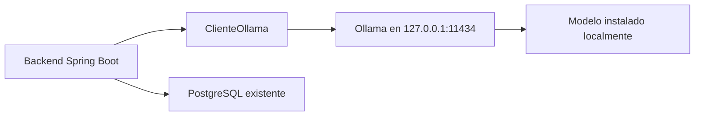

# IA local: conexión con Ollama

## Alcance de la etapa 2

El backend Java incorpora clientes de conversación y embeddings, una operación
de diagnóstico y configuración opcional. Se mantiene el monolito modular; no
se agregaron dependencias Maven, servicios Python ni frameworks de agentes.

Las pantallas de chatbot y agente, OCR, extracción documental, RAG e indexación
corresponden a etapas posteriores. El cliente todavía no consulta ni modifica
el conocimiento almacenado. Las pruebas reales usan únicamente texto sintético.

## Arquitectura



`ClienteConversacion` y `ClienteEmbeddings` permiten reemplazar Ollama por dobles
de prueba. `ClienteOllama` usa el cliente HTTP de Java 21 y Jackson existente.
El futuro orquestador podrá solicitar texto o una salida JSON con esquema.
El cliente verifica que esta última sea un objeto JSON; la validación específica
de nombres de herramientas y argumentos corresponde a la etapa 7.

Se utiliza `/api/chat` con `stream=false`, `think=false`, temperatura 0,
semilla 42, contexto acotado y `keep_alive=0`. Los embeddings usan `/api/embed`
con `truncate=false`. Estas opciones están documentadas en las APIs oficiales
de [conversación](https://docs.ollama.com/api/chat),
[embeddings](https://docs.ollama.com/api/embed) y
[salida estructurada](https://docs.ollama.com/capabilities/structured-outputs).

## Modelos

Los modelos de conversación y agente se configuran inicialmente como
`granite4.2:3b`, ya instalado. La selección y sus limitaciones están en
[INSTALACION_MODELOS.md](INSTALACION_MODELOS.md). El modelo visual queda reservado
para una evaluación posterior; la etapa 2 no recibe imágenes.

`embeddinggemma:300m` es el candidato configurado para embeddings. No está
instalado en esta computadora y no se descargó durante la etapa. El cliente se
verifica con vectores simulados hasta preparar el índice RAG.

## Habilitar en Windows

Abrir la aplicación Ollama y comprobar:

```powershell
ollama list
```

Si no hay un servidor activo, ejecutar `ollama serve` y dejar esa terminal abierta.
Cuando la aplicación de escritorio ya está sirviendo, no iniciar otro servidor
en el mismo puerto.

El script del proyecto admite un archivo privado `.local/ia-config.json`:

```json
{
  "IA_ENABLED": "true",
  "OLLAMA_BASE_URL": "http://127.0.0.1:11434",
  "OLLAMA_CHAT_MODEL": "granite4.2:3b",
  "OLLAMA_AGENT_MODEL": "granite4.2:3b",
  "OLLAMA_TIMEOUT": "120s"
}
```

Después de guardar esa configuración, reiniciar el backend con los scripts
descritos en [USO_WINDOWS.md](USO_WINDOWS.md). La configuración se carga solo al
iniciar el proceso. El archivo local tiene prioridad sobre las variables de IA
de esa terminal y acepta exclusivamente la lista de nombres admitidos por el script.

Para ejecución manual, exportar las variables de `backend/.env.example` en la
terminal: Spring Boot no carga automáticamente ese archivo. El valor por defecto
`IA_ENABLED=false` permite ejecutar la aplicación sin Ollama.

## Variables

| Variable | Valor inicial | Uso |
|---|---|---|
| `IA_ENABLED` | `false` | Habilita las llamadas de IA |
| `OLLAMA_BASE_URL` | `http://127.0.0.1:11434` | Servidor local |
| `OLLAMA_CHAT_MODEL` | `granite4.2:3b` | Conversación |
| `OLLAMA_AGENT_MODEL` | `granite4.2:3b` | Modelo propuesto para el agente |
| `OLLAMA_VISION_MODEL` | `qwen2.5vl:3b` | Reservado; no instalado ni utilizado |
| `OLLAMA_EMBEDDING_MODEL` | `embeddinggemma:300m` | Candidato; pendiente de instalar |
| `OLLAMA_TIMEOUT` | `120s` | Presupuesto total por operación, máximo 180 s |
| `OLLAMA_CONNECT_TIMEOUT` | `2s` | Conexión, máximo 10 s |
| `OLLAMA_CONTEXT_TOKENS` | `2048` | Contexto; rango 512–4096 |
| `IA_MAX_PROMPT_CHARS` | `4000` | Suma de mensajes y esquema JSON |
| `IA_MAX_OUTPUT_TOKENS` | `128` | Respuesta; rango 16–512 |
| `IA_MAX_EMBEDDING_BATCH` | `8` | Textos por lote, máximo 16 |
| `IA_MAX_RESPONSE_BYTES` | `1048576` | Bytes HTTP recibidos, máximo 2 MiB |

Los límites de caracteres no son una medición exacta de tokens. El ajuste del
contexto recuperado se hará al implementar RAG. Se usan dos hilos de inferencia,
acordes con los dos núcleos físicos detectados.

## Diagnóstico y errores

`GET /api/ia/estado` requiere un JWT de **ADMINISTRADOR**. Anónimo recibe 401;
LECTOR y EDITOR reciben 403. No genera respuestas ni carga modelos en memoria.
Informa habilitación, disponibilidad del servidor, versión y presencia de los
cuatro modelos configurados. `instalado=true` no garantiza calidad o compatibilidad
para una tarea; las capacidades se revisan antes de generar o vectorizar.

Sin Ollama activo, el diagnóstico habilitado responde 503. El resto de la
aplicación no depende de esa comprobación para iniciar o gestionar conocimiento.
Con IA deshabilitada, el diagnóstico responde sin conectarse a Ollama.
En ese estado las marcas `disponible=false` e `instalado=false` indican que no
se realizó una comprobación del servidor ni del inventario.

| Código | HTTP | Significado |
|---|---|---|
| `IA_DESHABILITADA` | 503 | Integración desactivada |
| `IA_NO_DISPONIBLE` | 503 | Conexión fallida o servidor saturado |
| `IA_MODELO_NO_INSTALADO` | 503 | Modelo ausente; no se descarga automáticamente |
| `IA_MODELO_INCOMPATIBLE` | 503 | Capacidad incorrecta o variante Thinking obligatoria |
| `IA_MODELO_REMOTO` | 503 | Metadatos de modelo remoto rechazados |
| `IA_TIMEOUT` | 504 | Se agotó el presupuesto de tiempo |
| `IA_OCUPADA` | 429 | Otra operación de IA está en curso |
| `IA_ENTRADA_INVALIDA` | 400 | Entrada vacía, formato incorrecto o límite superado |
| `IA_RESPUESTA_INVALIDA` | 502 | JSON inválido, respuesta excesiva o datos inconsistentes |
| `IA_RESPUESTA_INCOMPLETA` | 502 | El modelo agotó el límite de salida |

## Privacidad y límites

Solo se aceptan URLs HTTP de loopback, sin credenciales, rutas adicionales,
consultas ni fragmentos. No se siguen redirecciones ni se utiliza un proxy. Se
rechazan nombres cloud y metadatos de modelos remotos. El servidor Ollama local
y su administración forman parte del entorno de confianza.

Solo se permite una operación de generación o embeddings a la vez, sin reintentos
automáticos. El timeout incluye metadatos, cabeceras y recepción del cuerpo.
La respuesta se limita mientras llega, antes de acumular todo el JSON.
El límite de concurrencia corresponde a este backend; otros programas pueden
utilizar el mismo servidor Ollama independientemente.

Los errores públicos no incluyen el cuerpo remoto ni el prompt. El campo
`thinking` de Ollama no se expone en los DTO de respuesta. No se guardan prompts,
documentos o respuestas en la base durante esta etapa. El agente de la etapa 7
será exclusivamente textual y no generará tickets ni modificará conocimiento.

La configuración y la evaluación de modelos existentes sustituyen el entrenamiento
desde cero. Las pruebas sintéticas permiten evaluar factibilidad, pero no
demuestran por sí solas precisión con documentos reales ni ausencia de alucinaciones.

Antes de las pantallas de IA habrá que definir un timeout específico en Axios:
el cliente actual usa 15 segundos, menos que los tiempos medidos de inferencia.
La integración del navegador se realizará en las etapas de interfaz.

Pruebas y reversión: [PRUEBAS_IA.md](PRUEBAS_IA.md).
